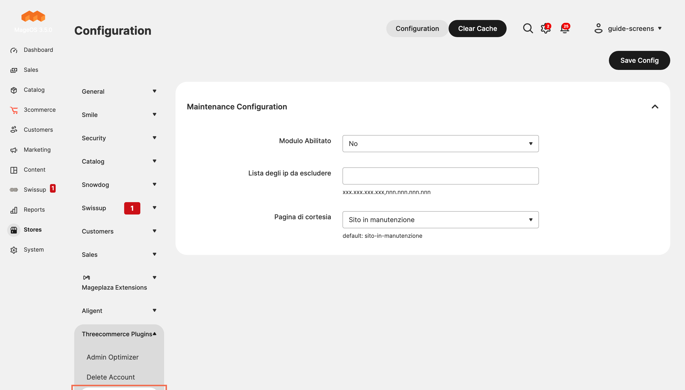
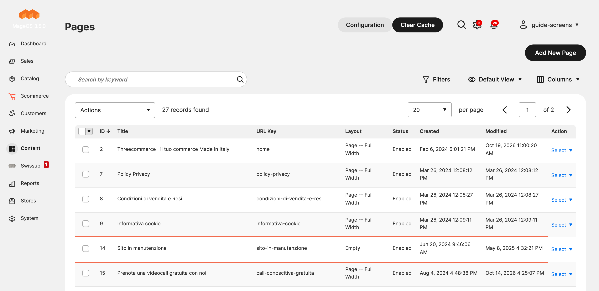

# Threecommerce_Maintenance: maintenance page for Magento 2 that works in developer mode, managed as a CMS page

Magento does not show its maintenance page in developer mode. This free module extends maintenance mode so the page is displayed there too, and manages it as a normal **CMS page**: install the module and the page is created for you, ready to customize.



**Compatibility:** Magento Open Source / Adobe Commerce 2.4.4 – 2.4.9 · Mage-OS 1.x / 3.x · PHP 8.1 – 8.4 · Themes: Luma, Hyvä, Breeze
**License:** free · **Current version:** see [Releases](../../releases)

## Features

- Shows a maintenance page also in **developer mode** (not supported out of the box).
- Creates a dedicated **CMS page** automatically, editable from the admin: no template to touch.
- **IP allow list**: the IPs you list are excluded from the maintenance page.
- Choose the courtesy page by its URL key (default `sito-in-manutenzione`).
- Console commands to enable and disable the maintenance page.



## Requirements

- Magento Open Source / Adobe Commerce 2.4.4+ or Mage-OS
- PHP 8.1 – 8.4
- Package: `threecommerce/m2-base` (installed automatically by Composer)

## Installation

The package is distributed through our Composer repository at `repo.threecommerce.it`. Request the credentials from the [product page](https://www.threecommerce.it/pagina-di-manutenzione-magento?utm_source=github&utm_medium=readme&utm_campaign=magento2-maintenance-page), then:

```bash
composer config repositories.threecommerce composer https://repo.threecommerce.it
composer require threecommerce/m2-maintenance
bin/magento module:enable Threecommerce_Maintenance
bin/magento setup:upgrade
bin/magento cache:flush
```

## Configuration

Admin → **Stores → Configuration → Threecommerce Plugins → Maintenance Config**: enable the module, IP list (comma separated), courtesy page. Edit the page in Content → Pages.

## Documentation and support

- Product page: [threecommerce.it/pagina-di-manutenzione-magento](https://www.threecommerce.it/pagina-di-manutenzione-magento?utm_source=github&utm_medium=readme&utm_campaign=magento2-maintenance-page)
- [Changelog](CHANGELOG.md) (in Italian)
- Support and custom development: [threecommerce.it/contatti](https://www.threecommerce.it/contatti?utm_source=github&utm_medium=readme&utm_campaign=magento2-maintenance-page)

---

*This repository is the public showcase of the module. The source code is kept in a private repository.*
